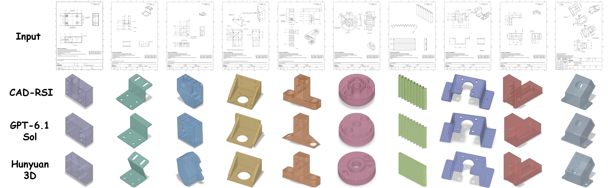
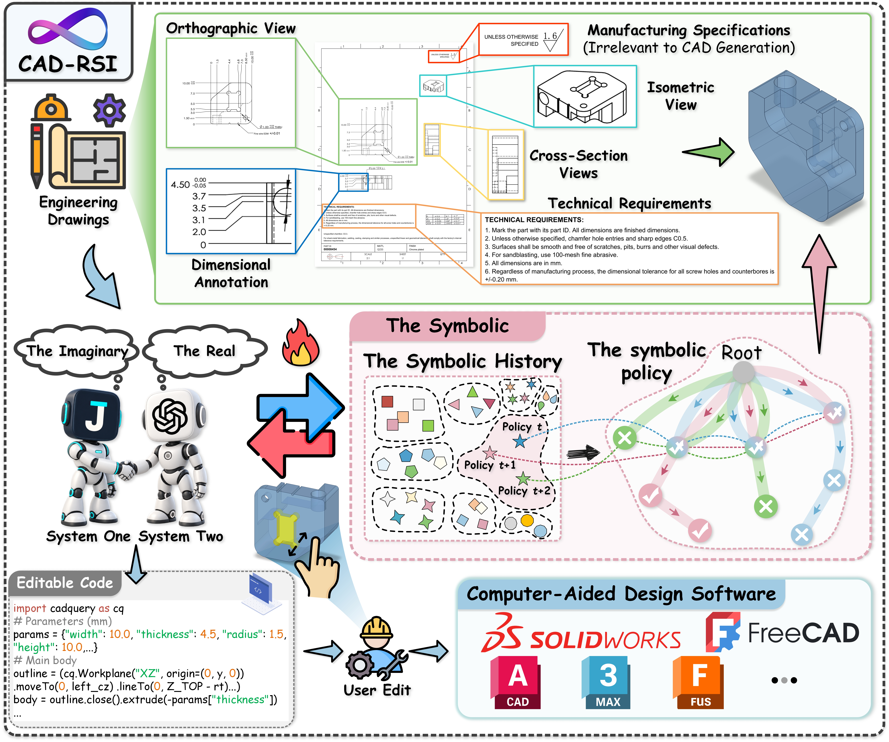
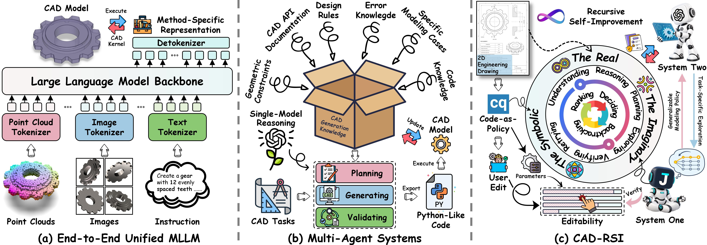
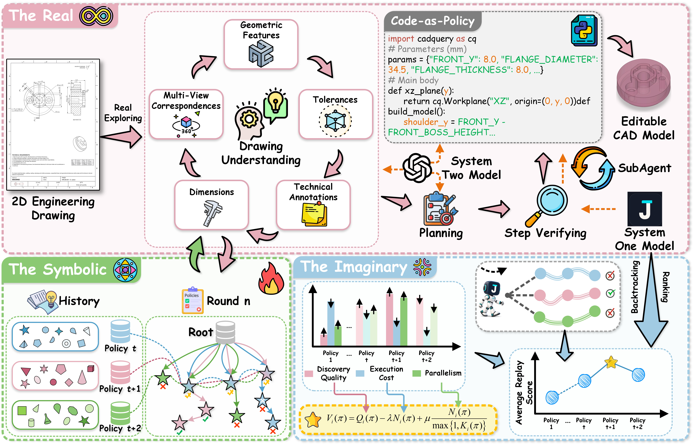
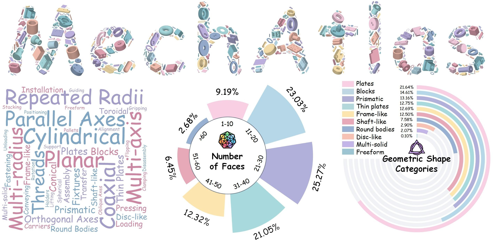
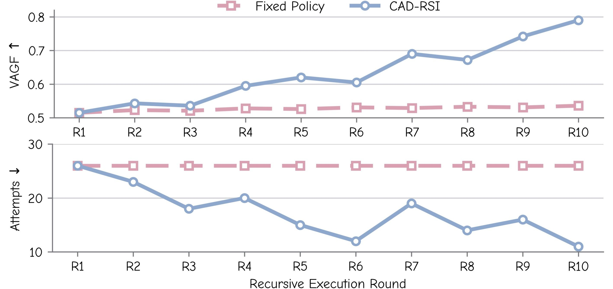

<div align="center">


<h1>CAD-RSI</h1>
<h3>Recursive Self-Improving CAD Reconstruction<br>from Engineering Drawings</h3>

<p><em>From engineering drawings to editable CAD, with modeling policies that improve through experience.</em></p>

<p>
  Xu Xu<sup>1</sup> · Zhangbo Qiao<sup>1</sup> · Jinxiu Liu<sup>2</sup> · Xuanming Liu<sup>3</sup> · Cheng Song<sup>4</sup> · Weiyang Liu<sup>2,*</sup>
</p>
<p>
  <sup>1</sup> Beihang University &nbsp; <sup>2</sup> The Chinese University of Hong Kong<br>
  <sup>3</sup> Westlake University &nbsp; <sup>4</sup> National University of Singapore<br>
  <sub>* Corresponding author</sub>
</p>

<p>
  <a href="https://xxu895630-cmd.github.io/CAD-RSI/"></a>
  <a href="https://huggingface.co/datasets/XUXU666/MechAtlas"></a>
</p>
<p>
  <a href="MechAtlas_300_samples"></a>
  <a href="evaluation/README.md"></a>
</p>

<p>
  <a href="#overview">Overview</a> ·
  <a href="#method">Method</a> ·
  <a href="#mechatlas">MechAtlas</a> ·
  <a href="#results">Results</a> ·
  <a href="#quick-start">Quick Start</a>
</p>


<p><sub>Reconstructing mechanical parts from engineering drawings while preserving local geometric details.</sub></p>

</div>

---

<a id="overview"></a>

## ✨ Overview

**CAD-RSI** reconstructs editable CAD models from standardized engineering drawings through **recursive self-improvement**. It turns multi-view geometry, dimensions, tolerances, and technical annotations into executable **CadQuery programs**, while learning reusable symbolic modeling policies from accumulated execution experience.

The framework improves its policies **without updating model weights**. Historical backtracking reuses recorded outcomes to evaluate candidate policies, and a dual-system design assigns rapid decisions and deliberate reasoning to complementary models.

| Capability | What it contributes |
| :--- | :--- |
| **Editable CAD reconstruction** | Executable CadQuery programs produce CAD geometry that supports further editing and design. |
| **Generalizable modeling policies** | Symbolic policies distill experience into strategies that guide subsequent exploration. |
| **Historical backtracking** | Candidate policies are evaluated on recorded trajectories without repeating CAD code generation or execution. |
| **Dual-system coordination** | System One handles rapid decisions; System Two handles drawing understanding, planning, code generation, verification, and policy refinement. |

<details>
<summary><b>View the task overview and comparison of CAD generation paradigms</b></summary>

<p align="center">
  
</p>

<p align="center">
  
</p>

CAD-RSI connects CAD execution, historical backtracking, and policy refinement in a recursive loop.

</details>

<a id="method"></a>

## 🧠 Method

<p align="center">
  
</p>

1. **The Real — explore and record.** Interpret the drawing, plan modeling operations, generate and execute CadQuery code, and verify the resulting model. Record successes, failures, feedback, and computational costs.
2. **The Imaginary — backtrack and evaluate.** Revisit recorded exploration trees to evaluate and rank candidate modeling policies using existing outcomes.
3. **The Symbolic — refine and reuse.** Revise symbolic policy code with evaluation feedback, then use the selected policy to guide the next round of exploration.

**System One** makes fast exploration, backtracking, and ranking decisions. **System Two** performs detailed reasoning and policy refinement. Together, they reduce redundant reasoning during long-horizon reconstruction.

<a id="mechatlas"></a>

## 📐 MechAtlas

**MechAtlas** is the benchmark introduced in our work, comprising **49,662 engineering drawings paired with STEP models**. The drawings were manually drafted and reviewed by professional CAD engineers and used in industrial production.

The **[full MechAtlas dataset (49,662 samples)](https://huggingface.co/datasets/XUXU666/MechAtlas)** is hosted on Hugging Face. **This code repository currently includes the 300-sample evaluation set and STEP evaluation scripts.**

| Resource | Scope | Access |
| :--- | :--- | :--- |
| **Full MechAtlas dataset** | 49,662 samples | [Hugging Face: XUXU666/MechAtlas](https://huggingface.co/datasets/XUXU666/MechAtlas) |
| **Evaluation set** | 300 samples used for evaluation | [MechAtlas_300_samples](MechAtlas_300_samples) |
| **Evaluation scripts** | STEP geometry metrics and protocol | [Evaluation guide](evaluation/README.md) |

The full dataset is gated on Hugging Face. Sign in and follow the access instructions on the dataset page to download it.

<p align="center">
  
  <br><sub>Geometric diversity of the full MechAtlas benchmark.</sub>
</p>

The evaluation set is selected using geometric-family and complexity stratification, representative sampling, and coverage constraints. Each sample provides four files with the same identifier:

| File | Contents |
| :--- | :--- |
| `<ID>.png` | Engineering drawing image. |
| `<ID>.pdf` | Engineering drawing in PDF format. |
| `<ID>.step` | Ground-truth CAD geometry for evaluation. |
| `<ID>.py` | CadQuery/OCP reference geometry reconstruction script. |

The per-sample Python files accompany the reference geometry; they are not the CAD-RSI reconstruction framework. The evaluator reads STEP files and does not execute these scripts.

<details>
<summary><b>Repository layout</b></summary>

```text
CAD-RSI/
├── README.md
├── asset/
│   └── figures/                  # Logo and paper figures
├── evaluation/
│   ├── README.md                # Evaluation protocol and metric definitions
│   ├── requirements.txt         # Pinned evaluation dependencies
│   └── evaluate.py              # STEP evaluation entry point
└── MechAtlas_300_samples/
    ├── 00000117/
    │   ├── 00000117.png
    │   ├── 00000117.pdf
    │   ├── 00000117.step
    │   └── 00000117.py
    └── ...                      # 300 sample directories in total
```

</details>

<a id="results"></a>

## 📊 Results

Selected results reported in our manuscript on the **300-sample MechAtlas evaluation set**. All methods in the table below use **GPT-5.5** as their backbone.

| Method | IR (%) ↓ | IoU (%) ↑ | SIoU (%) ↑ | Median CD ↓ | Mean CD ↓ | VAGF ↑ |
| :--- | ---: | ---: | ---: | ---: | ---: | ---: |
| GPT-5.5 | 42.00 | 75.48 | 76.67 | 0.1199 | 1.517 | 0.3250 |
| IterCAD | 3.00 | 77.09 | 79.91 | 0.1502 | 3.897 | 0.4675 |
| Ortho2CAD-ITS | 1.33 | 79.14 | 83.15 | 0.1503 | 2.649 | 0.4707 |
| **CAD-RSI** | **0.00** | **91.49** | **94.09** | **0.0131** | **0.456** | **0.8321** |

**IR** denotes the **Invalidity Ratio**, the percentage of invalid outputs (lower is better). CD is displayed in units of **10⁻³**. Geometric metrics are aggregated over eligible valid reconstructions; **VAGF** accounts for all evaluation samples, including invalid outputs.

In the manuscript's MechAtlas ablation with GPT-5.5, historical backtracking and dual-system coordination reduce average per-task token consumption from **37.8K to 23.1K (38.9%)** and inference time from **125.1 s to 51.9 s (58.5%)**, relative to the variant without either component. VAGF changes from **0.8347 to 0.8321**.

<details>
<summary><b>View recursive policy evolution</b></summary>

<p align="center">
  
</p>

On the single reconstruction task shown in this analysis, recursive policy evolution improves geometric fidelity while reducing modeling attempts across rounds.

</details>

<a id="quick-start"></a>

## 🚀 Quick Start: Evaluate Your STEP Predictions

Use **Python 3.9–3.11** in a dedicated environment. The commands below evaluate STEP predictions that you generate with your own reconstruction method.

### 1. Get the repository and install dependencies

```bash
git clone https://github.com/xxu895630-cmd/CAD-RSI.git
cd CAD-RSI
python -m venv .venv
```

Activate the environment using the command for your shell:

```bash
# Linux / macOS
source .venv/bin/activate
```

```powershell
# Windows PowerShell
.\.venv\Scripts\Activate.ps1
```

Then install the evaluator's pinned dependencies:

```bash
python -m pip install -r evaluation/requirements.txt
```

### 2. Prepare predictions

Export one `.step` or `.stp` file per sample. Keep each sample ID and its leading zeros:

```text
predictions/
├── 00000117.step
├── 00000228.step
└── ...
```

Batch evaluation recursively matches predictions and references by their **case-sensitive filename stem**. Missing predictions count as invalid outputs. Duplicate IDs and prediction IDs absent from the ground-truth set are rejected.

### 3. Run evaluation

From the repository root:

```bash
python evaluation/evaluate.py --prediction predictions --ground-truth MechAtlas_300_samples --output scores.json
```

To evaluate a single sample:

```bash
python evaluation/evaluate.py --prediction predictions/00000117.step --ground-truth MechAtlas_300_samples/00000117/00000117.step --output score_00000117.json
```

The JSON report contains **settings**, **summary**, and **per_sample** results. Defaults are **8,192 surface samples per shape** and **similarity alignment**. Use `--alignment rigid` to disable scale fitting, and keep evaluation settings consistent across methods.

| Metric | Interpretation |
| :--- | :--- |
| **IoU ↑** | Volumetric intersection over union for eligible solid pairs. |
| **SIoU ↑** | Bidirectional surface coverage within a distance threshold. |
| **CD ↓** | Sum of the two mean squared nearest-neighbor surface distances. |
| **VAGF ↑** | Validity-Aware Geometric Fidelity over the complete evaluation set; missing or invalid predictions contribute zero. |

**Reading scores:** IoU and SIoU are fractions in JSON. Multiply by 100 for percentages. JSON stores raw CD; multiply by 1,000 for the manuscript's display units. VAGF uses raw CD. A report with `summary.complete == false` is incomplete and should be rerun after resolving the reported errors.

See the **[evaluation guide](evaluation/README.md)** for the full alignment procedure, validity rules, metric definitions, timeout controls, and IoU fallback behavior.

---

## 🗓️ Release Roadmap

- [x] Release the **[full MechAtlas dataset on Hugging Face](https://huggingface.co/datasets/XUXU666/MechAtlas)**.
- [x] Release the **300-sample MechAtlas evaluation set**.
- [x] Release **STEP evaluation scripts** and evaluation documentation.
- [ ] **arXiv coming soon.** The paper has not yet been made public; the preprint link and BibTeX entry will be added here when available.
- [ ] **Full code coming soon.** The complete CAD-RSI framework, including reconstruction, historical backtracking, and recursive policy evolution, will be released in a future update.

For questions about the evaluation set or scripts, please open an **[issue](https://github.com/xxu895630-cmd/CAD-RSI/issues)**. If this project is useful to your research, consider starring the repository to follow its progress.
